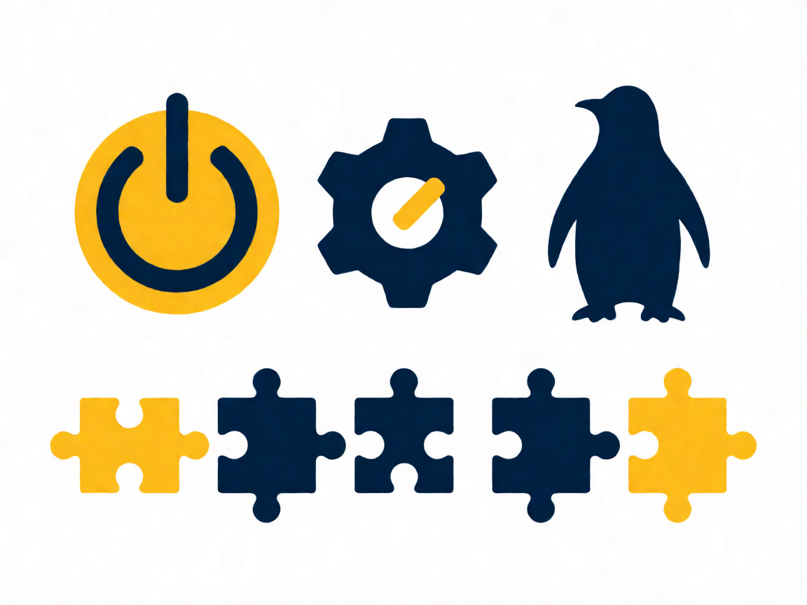

# 🖥️ Tema 101: Arquitectura del Sistema

Examen 101-500 · v5.0 · Fuente canónica: https://learning.lpi.org/es/learning-materials/101-500/ · Objetivos: https://www.lpi.org/es/exam-101-102-objectives/

Documentos por objetivo: cada carpeta `NNN.N-slug/` contiene `README.md` (ficha), `RESUMEN.md` (comandos+conceptos+trampas), `EJERCICIOS.md` (labs estilo LPI en VM) y `tools/` (apps HTML).

| Objetivo | Título | Peso | Carpeta |
|---|---|---|---|
| 101.1 | Determinar y configurar ajustes de hardware | w2 | [101.1-Determinar-y-configurar-ajustes-hardware](./101.1-Determinar-y-configurar-ajustes-hardware/) |
| 101.2 | Arrancar el sistema | w3 | [101.2-Arrancar-el-sistema](./101.2-Arrancar-el-sistema/) |
| 101.3 | Cambiar runlevels/targets y apagar o reiniciar | w3 | [101.3-Cambiar-niveles-de-ejecucion-targets-y-apagar-o-reiniciar](./101.3-Cambiar-niveles-de-ejecucion-targets-y-apagar-o-reiniciar/) |

Fuentes completas del tema: `RESUMEN-TEMA-COMPLETO.md`, `EJERCICIOS-TEMA-COMPLETO.md` (heredados de la fase por-temas).
(Nota v5.0: en Tema 104 el objetivo 104.4 está eliminado; la numeración salta de 104.3 a 104.5.)

**Presentación PDF:** [`Presentacion-Tema-101.pdf`](Presentacion-Tema-101.pdf) — generada con reportlab (portada+índice+diapos por objetivo+tabla+lab+quiz+soluciones+créditos, imágenes Wikimedia Commons con atribución).
