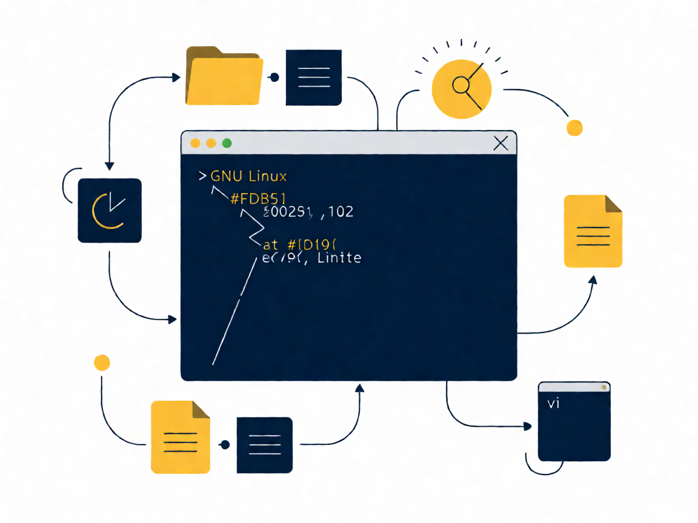

# ⌨️ Tema 103: Comandos GNU y Unix

Examen 101-500 · v5.0 · Fuente canónica: https://learning.lpi.org/es/learning-materials/101-500/ · Objetivos: https://www.lpi.org/es/exam-101-102-objectives/

Documentos por objetivo: cada carpeta `NNN.N-slug/` contiene `README.md` (ficha), `RESUMEN.md` (comandos+conceptos+trampas), `EJERCICIOS.md` (labs estilo LPI en VM) y `tools/` (apps HTML).

| Objetivo | Título | Peso | Carpeta |
|---|---|---|---|
| 103.1 | Trabajar en la línea de comandos | w4 | [103.1-Trabajar-en-la-linea-de-comandos](./103.1-Trabajar-en-la-linea-de-comandos/) |
| 103.2 | Procesar flujos de texto usando filtros | w2 | [103.2-Procesar-flujos-de-texto-usando-filtros](./103.2-Procesar-flujos-de-texto-usando-filtros/) |
| 103.3 | Gestión básica de archivos | w4 | [103.3-Realizar-gestion-basica-de-archivos](./103.3-Realizar-gestion-basica-de-archivos/) |
| 103.4 | Flujos, pipes y redirecciones | w4 | [103.4-Usar-flujos-pipes-y-redirecciones](./103.4-Usar-flujos-pipes-y-redirecciones/) |
| 103.5 | Crear, monitorizar y terminar procesos | w4 | [103.5-Crear-monitorizar-y-terminar-procesos](./103.5-Crear-monitorizar-y-terminar-procesos/) |
| 103.6 | Modificar prioridades de ejecución | w2 | [103.6-Modificar-prioridades-de-ejecucion-de-procesos](./103.6-Modificar-prioridades-de-ejecucion-de-procesos/) |
| 103.7 | Búsquedas con expresiones regulares | w3 | [103.7-Buscar-en-archivos-de-texto-usando-expresiones-regulares](./103.7-Buscar-en-archivos-de-texto-usando-expresiones-regulares/) |
| 103.8 | Edición básica con vi | w3 | [103.8-Realizar-edicion-basica-de-archivos-usando-vi](./103.8-Realizar-edicion-basica-de-archivos-usando-vi/) |

Fuentes completas del tema: `RESUMEN-TEMA-COMPLETO.md`, `EJERCICIOS-TEMA-COMPLETO.md` (heredados de la fase por-temas).
(Nota v5.0: en Tema 104 el objetivo 104.4 está eliminado; la numeración salta de 104.3 a 104.5.)

**Presentación PDF:** [`Presentacion-Tema-103.pdf`](Presentacion-Tema-103.pdf) — generada con reportlab (portada+índice+diapos por objetivo+tabla+lab+quiz+soluciones+créditos, imágenes Wikimedia Commons con atribución).
