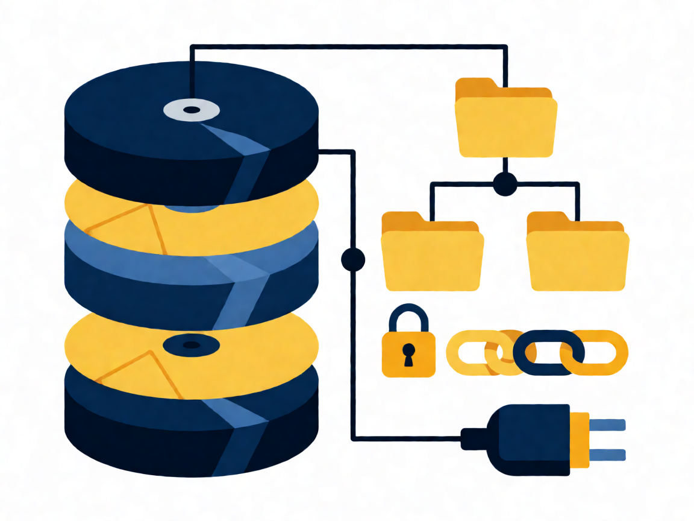

# 💾 Tema 104: Dispositivos, sistemas de archivos y FHS

Examen 101-500 · v5.0 · Fuente canónica: https://learning.lpi.org/es/learning-materials/101-500/ · Objetivos: https://www.lpi.org/es/exam-101-102-objectives/

Documentos por objetivo: cada carpeta `NNN.N-slug/` contiene `README.md` (ficha), `RESUMEN.md` (comandos+conceptos+trampas), `EJERCICIOS.md` (labs estilo LPI en VM) y `tools/` (apps HTML).

| Objetivo | Título | Peso | Carpeta |
|---|---|---|---|
| 104.1 | Crear particiones y sistemas de archivos | w2 | [104.1-Crear-particiones-y-sistemas-de-archivos](./104.1-Crear-particiones-y-sistemas-de-archivos/) |
| 104.2 | Mantener la integridad de los sistemas de archivos | w2 | [104.2-Mantener-la-integridad-de-sistemas-de-archivos](./104.2-Mantener-la-integridad-de-sistemas-de-archivos/) |
| 104.3 | Controlar el montaje y desmontaje | w3 | [104.3-Controlar-el-montaje-y-desmontaje-de-sistemas-de-archivos](./104.3-Controlar-el-montaje-y-desmontaje-de-sistemas-de-archivos/) |
| 104.5 | Permisos y propiedad de archivos | w3 | [104.5-Gestionar-permisos-y-propiedad-de-archivos](./104.5-Gestionar-permisos-y-propiedad-de-archivos/) |
| 104.6 | Enlaces duros y simbólicos | w2 | [104.6-Crear-y-cambiar-enlaces-duros-y-simbolicos](./104.6-Crear-y-cambiar-enlaces-duros-y-simbolicos/) |
| 104.7 | FHS y localización de archivos | w2 | [104.7-Encontrar-archivos-del-sistema-y-ubicarlos-en-el-lugar-correcto](./104.7-Encontrar-archivos-del-sistema-y-ubicarlos-en-el-lugar-correcto/) |

Fuentes completas del tema: `RESUMEN-TEMA-COMPLETO.md`, `EJERCICIOS-TEMA-COMPLETO.md` (heredados de la fase por-temas).
(Nota v5.0: en Tema 104 el objetivo 104.4 está eliminado; la numeración salta de 104.3 a 104.5.)

**Presentación PDF:** [`Presentacion-Tema-104.pdf`](Presentacion-Tema-104.pdf) — generada con reportlab (portada+índice+diapos por objetivo+tabla+lab+quiz+soluciones+créditos, imágenes Wikimedia Commons con atribución).
