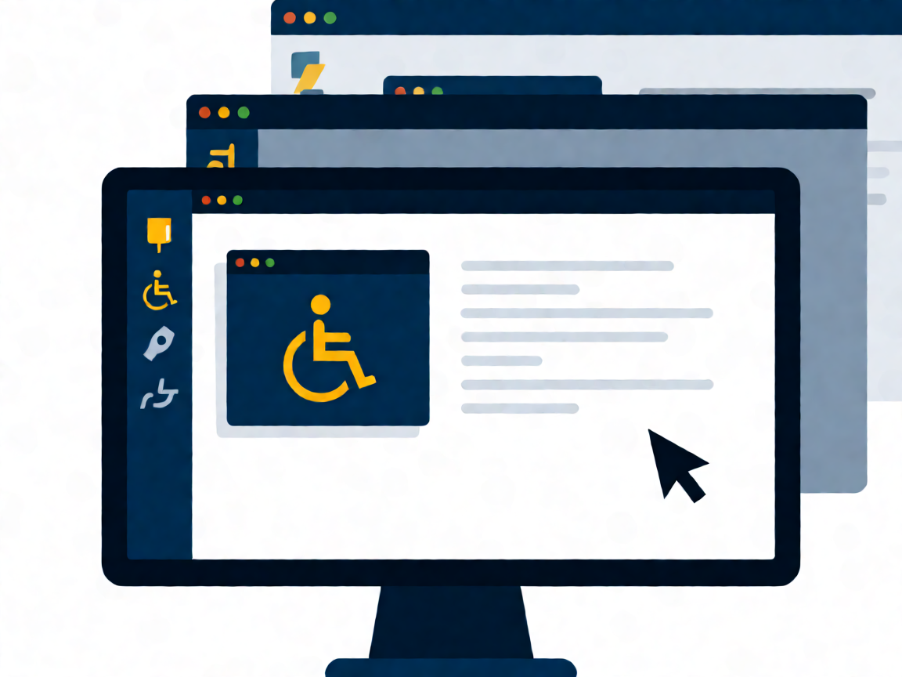

# 🖼️ Tema 106: Interfaces de usuario y escritorios

Examen 102-500 · v5.0 · Fuente canónica: https://learning.lpi.org/es/learning-materials/102-500/ · Objetivos: https://www.lpi.org/es/exam-101-102-objectives/

Documentos por objetivo: cada carpeta `NNN.N-slug/` contiene `README.md` (ficha), `RESUMEN.md` (comandos+conceptos+trampas), `EJERCICIOS.md` (labs estilo LPI en VM) y `tools/` (apps HTML).

| Objetivo | Título | Peso | Carpeta |
|---|---|---|---|
| 106.1 | Instalar y configurar X11 | w2 | [106.1-Instalar-y-configurar-X11](./106.1-Instalar-y-configurar-X11/) |
| 106.2 | Escritorios gráficos | w1 | [106.2-Gestor-de-pantalla-grafico](./106.2-Gestor-de-pantalla-grafico/) |
| 106.3 | Accesibilidad | w1 | [106.3-Accesibilidad](./106.3-Accesibilidad/) |

Fuentes completas del tema: `RESUMEN-TEMA-COMPLETO.md`, `EJERCICIOS-TEMA-COMPLETO.md` (heredados de la fase por-temas).
(Nota v5.0: en Tema 104 el objetivo 104.4 está eliminado; la numeración salta de 104.3 a 104.5.)

**Presentación PDF:** [`Presentacion-Tema-106.pdf`](Presentacion-Tema-106.pdf) — generada con reportlab (portada+índice+diapos por objetivo+tabla+lab+quiz+soluciones+créditos, imágenes Wikimedia Commons con atribución).
