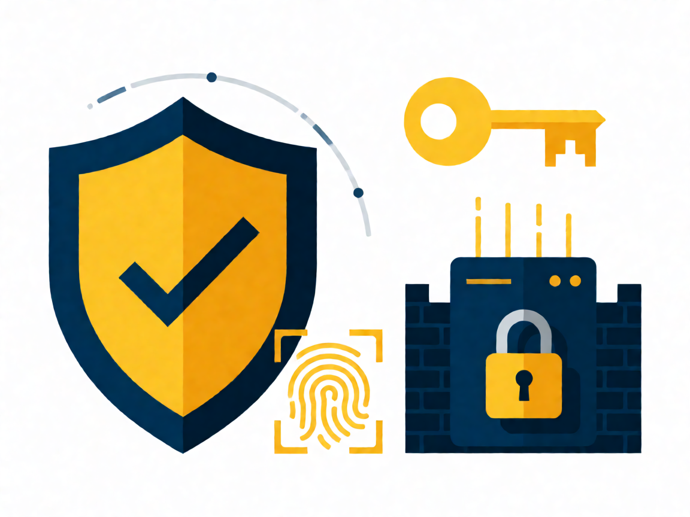

# 🔒 Tema 110: Seguridad

Examen 102-500 · v5.0 · Fuente canónica: https://learning.lpi.org/es/learning-materials/102-500/ · Objetivos: https://www.lpi.org/es/exam-101-102-objectives/

Documentos por objetivo: cada carpeta `NNN.N-slug/` contiene `README.md` (ficha), `RESUMEN.md` (comandos+conceptos+trampas), `EJERCICIOS.md` (labs estilo LPI en VM) y `tools/` (apps HTML).

| Objetivo | Título | Peso | Carpeta |
|---|---|---|---|
| 110.1 | Tareas de administración de seguridad | w3 | [110.1-Realizar-tareas-de-administracion-de-seguridad](./110.1-Realizar-tareas-de-administracion-de-seguridad/) |
| 110.2 | Seguridad del host | w3 | [110.2-Configurar-la-seguridad-del-host](./110.2-Configurar-la-seguridad-del-host/) |
| 110.3 | Cifrado de datos | w4 | [110.3-Asegurar-datos-con-cifrado](./110.3-Asegurar-datos-con-cifrado/) |

Fuentes completas del tema: `RESUMEN-TEMA-COMPLETO.md`, `EJERCICIOS-TEMA-COMPLETO.md` (heredados de la fase por-temas).
(Nota v5.0: en Tema 104 el objetivo 104.4 está eliminado; la numeración salta de 104.3 a 104.5.)

**Presentación PDF:** [`Presentacion-Tema-110.pdf`](Presentacion-Tema-110.pdf) — generada con reportlab (portada+índice+diapos por objetivo+tabla+lab+quiz+soluciones+créditos, imágenes Wikimedia Commons con atribución).
