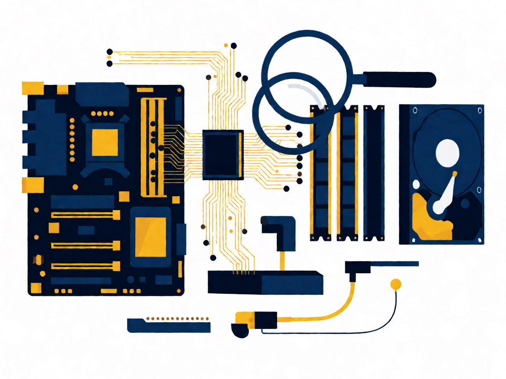
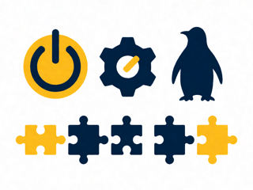
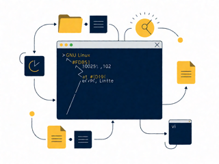
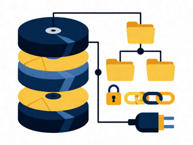
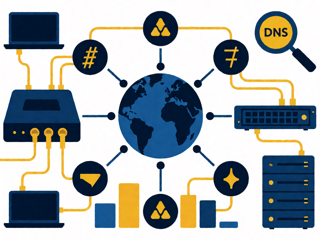

# 🐧 LPIC-1 v5.0 (101-500 + 102-500) — Curso propio por objetivos


> 💡 **Curso virtual 19/10–13/11/2026 (17–20 h, 48 h, Webex)** — fechas, horario y cronograma en la presentación de [`00-Presentacion/`](00-Presentacion/) (cliente Feval).

Contenido propio que cubre los objetivos oficiales v5.0 (no se copia ni adapta el material LPI: solo se referencia y enlaza).

## 🗂️ Estructura del repo

```
LPIC1/
├── README.md                  ← este fichero (portada + guía)
├── 00-Presentacion/           ← 🎓 presentación Feval (html+pdf) + PDFs de infra VirtualBox
├── 101/                       ← 🎯 examen 101-500 (Temas 101–104)
├── 102/                       ← 🎯 examen 102-500 (Temas 105–110)
├── docs/                      ← 🖥️ app web de prácticas (812 preguntas, GitHub Pages)
└── assets/
    ├── portadas/              ← 🖼️ portadas por examen y tema (integradas aquí abajo)
    └── img/                   ← fotos Wikimedia para las presentaciones
```

Cada carpeta de objetivo `NNN.N-slug/` contiene SIEMPRE estos 4 documentos:

| Documento | Contenido |
|---|---|
| `README.md` | 📄 Ficha: peso, áreas, ficheros/comandos, enlaces oficiales |
| `RESUMEN.md` | 🧠 Comandos+opciones, archivos, conceptos, trampas |
| `EJERCICIOS.md` | ⌨️ Labs estilo LPI (Objetivo→Pasos→Comprobación→Solución), solo VM |
| `tools/` | 🖥️ App HTML interactiva del objetivo (+ `tools/README.md` puntero) |

Además cada carpeta de Tema guarda `RESUMEN-TEMA-COMPLETO.md` y `EJERCICIOS-TEMA-COMPLETO.md` como fuente agregada, su `Presentacion-Tema-NN.pdf` y guías propias "Tema NN" en PDF.

## 🎯 Examen 101-500 — Instalación, comandos y filesystems



| Tema | Portada | Objetivos (peso) | Carpeta | Presentación |
|---|---|---|---|---|
| 🖥️ 101 Arquitectura (w8) |  | 101.1 (2), 101.2 (3), 101.3 (3) | [101-Arquitectura-del-Sistema](101/101-Arquitectura-del-Sistema/) | [Presentacion-Tema-101.pdf](101/101-Arquitectura-del-Sistema/Presentacion-Tema-101.pdf) |
| 📦 102 Instalación/paquetes (w12) |  | 102.1 (2), 102.2 (2), 102.3 (1), 102.4 (3), 102.5 (3), 102.6 (1) | [102-Instalacion-de-Linux-y-Gestion-de-Paquetes](101/102-Instalacion-de-Linux-y-Gestion-de-Paquetes/) | [Presentacion-Tema-102.pdf](101/102-Instalacion-de-Linux-y-Gestion-de-Paquetes/Presentacion-Tema-102.pdf) |
| ⌨️ 103 Comandos GNU/Unix (w26) |  | 103.1 (4), 103.2 (2), 103.3 (4), 103.4 (4), 103.5 (4), 103.6 (2), 103.7 (3), 103.8 (3) | [103-Comandos-GNU-y-Unix](101/103-Comandos-GNU-y-Unix/) | [Presentacion-Tema-103.pdf](101/103-Comandos-GNU-y-Unix/Presentacion-Tema-103.pdf) |
| 💾 104 Filesystems/FHS (w14) |  | 104.1 (2), 104.2 (2), 104.3 (3), ~~104.4 eliminado~~, 104.5 (3), 104.6 (2), 104.7 (2) | [104-Dispositivos-Sistemas-de-Archivos-Linux-y-Jerarquia-Estandar](101/104-Dispositivos-Sistemas-de-Archivos-Linux-y-Jerarquia-Estandar/) | [Presentacion-Tema-104.pdf](101/104-Dispositivos-Sistemas-de-Archivos-Linux-y-Jerarquia-Estandar/Presentacion-Tema-104.pdf) |

Estrategia: dominar 103 + 104. Practicar en Debian y Rocky en paralelo (apt vs dnf). Detalle en [101/README.md](101/README.md). Previos: [101/prev-quest/](101/prev-quest/) · Posteriores: [101/post-quest/](101/post-quest/).

## 🎯 Examen 102-500 — Shells, admin, servicios, redes y seguridad


| Tema | Portada | Objetivos (peso) | Carpeta | Presentación |
|---|---|---|---|---|
| 📜 105 Shells/scripts (w8) |  | 105.1 (4), 105.2 (4) | [105-Shells-y-Scripts-de-Shell](102/105-Shells-y-Scripts-de-Shell/) | [Presentacion-Tema-105.pdf](102/105-Shells-y-Scripts-de-Shell/Presentacion-Tema-105.pdf) |
| 🖼️ 106 Interfaces (w4) |  | 106.1 (2), 106.2 (1), 106.3 (1) | [106-Interfaces-de-Usuario-y-Escritorios](102/106-Interfaces-de-Usuario-y-Escritorios/) | [Presentacion-Tema-106.pdf](102/106-Interfaces-de-Usuario-y-Escritorios/Presentacion-Tema-106.pdf) |
| 👥 107 Admin (w12) |  | 107.1 (5), 107.2 (4), 107.3 (3) | [107-Tareas-Administrativas](102/107-Tareas-Administrativas/) | [Presentacion-Tema-107.pdf](102/107-Tareas-Administrativas/Presentacion-Tema-107.pdf) |
| ⚙️ 108 Servicios (w12) |  | 108.1 (3), 108.2 (4), 108.3 (3), 108.4 (2) | [108-Servicios-Esenciales-del-Sistema](102/108-Servicios-Esenciales-del-Sistema/) | [Presentacion-Tema-108.pdf](102/108-Servicios-Esenciales-del-Sistema/Presentacion-Tema-108.pdf) |
| 🌐 109 Redes (w14) |  | 109.1 (4), 109.2 (4), 109.3 (4), 109.4 (2) | [109-Fundamentos-de-Redes](102/109-Fundamentos-de-Redes/) | [Presentacion-Tema-109.pdf](102/109-Fundamentos-de-Redes/Presentacion-Tema-109.pdf) |
| 🔒 110 Seguridad (w10) |  | 110.1 (3), 110.2 (3), 110.3 (4) | [110-Seguridad](102/110-Seguridad/) | [Presentacion-Tema-110.pdf](102/110-Seguridad/Presentacion-Tema-110.pdf) |

Estrategia: 107.1 (w5, el objetivo de mayor peso) + 109 + 108.2 son el núcleo. Detalle en [102/README.md](102/README.md). Previos: [102/prev-quest/](102/prev-quest/).

## 📊 Presentaciones PDF (10, una por tema en su carpeta)

Contenido propio, estética LPI: portada + índice + diapo por objetivo + tabla de comandos + lab + quiz + soluciones + créditos. Imágenes de Wikimedia Commons con atribución (ver diapo final de cada PDF).

## 🖥️ App de prácticas web (carpeta [`docs/`](docs/), GitHub Pages)

812 preguntas solo de 101+102, sin referencias de origen: modos completo / reducido / práctica / personalizado y estadísticas locales.

## 🧠 Ruta de estudio

1. 📖 Por objetivo: `README` → `RESUMEN` (+`man`) → `EJERCICIOS` en VM (Debian + Rocky) → repasa con su app `tools/`.
2. 📝 Haz los `prev-quest/` antes de cada bloque y los `post-quest/` después.
3. ✅ Practica en la [app web](docs/) hasta ≥60% estable (apto orientativo ≥480/800).
4. 🔗 Contrasta siempre con la documentación oficial de abajo.

## 🔗 Documentación oficial LPI

> Los PDFs oficiales de LPI (licencia CC BY-NC-ND 4.0) no se copian ni distribuyen aquí: se accede desde las fuentes oficiales.

| Recurso | Enlace |
|---|---|
| 🏠 Certificación LPIC-1 (overview) | https://www.lpi.org/es/our-certifications/lpic-1-overview/ |
| 🎯 Objetivos 101+102 v5.0 (temario oficial) | https://www.lpi.org/es/exam-101-102-objectives/ |
| 📘 Learning Materials 101-500 | https://learning.lpi.org/es/learning-materials/101-500/ |
| 📗 Learning Materials 102-500 | https://learning.lpi.org/es/learning-materials/102-500/ |
| 📕 PDF oficial 101-500 (descarga LPI) | https://learning.lpi.org/pdfstore/LPI-Learning-Material-101-500-es.pdf |
| 📙 PDF oficial 102-500 (descarga LPI) | https://learning.lpi.org/pdfstore/LPI-Learning-Material-102-500-es.pdf |
| 💻 Repositorio GitHub oficial LPI | https://github.com/LinuxProfessional |
| 📝 Exámenes (Pearson VUE / LPI) | https://www.lpi.org/es/exam-pricing/ |

Recursos libres complementarios: [Arch Wiki](https://wiki.archlinux.org/) · [Debian Reference](https://www.debian.org/doc/) · [RHEL Documentation](https://docs.redhat.com/) · [man7.org](https://man7.org/linux/man-pages/) · [FHS 3.0](https://refspecs.linuxfoundation.org/FHS_3.0/fhs/index.html).

⚠️ Aviso legal: contenido propio. LPI®/LPIC-1® marcas de Linux Professional Institute. Portadas generadas por IA para este curso, sin usar el logo oficial.
